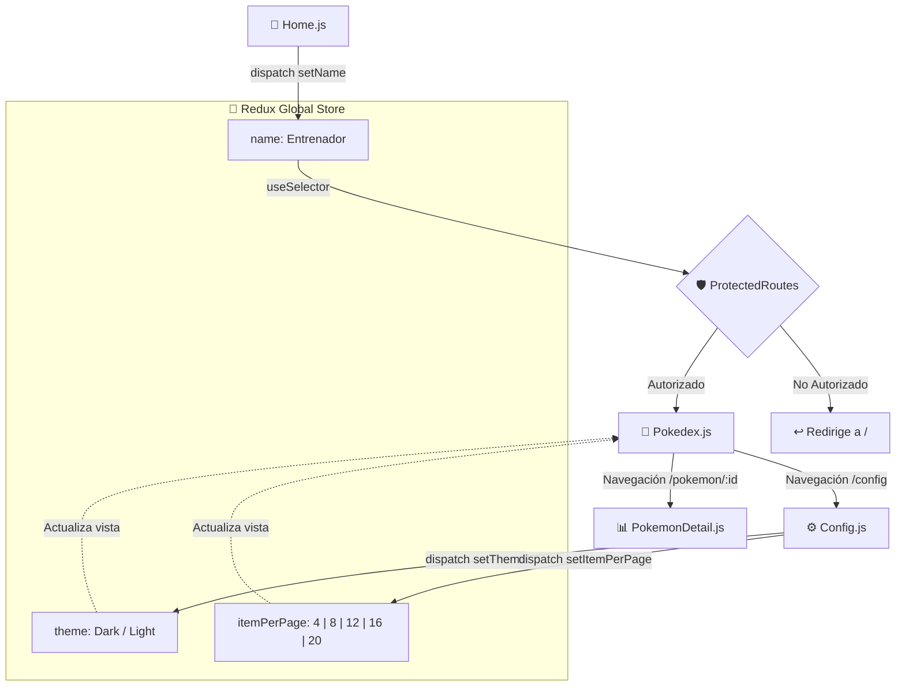

<div align="center">

# ⚡ Pokédex · Pokédex Interactiva con React & Redux

[](https://reactjs.org/)
[](https://redux.js.org/)
[](https://reactrouter.com/)
[](https://pokeapi.co/)
[](https://axios-http.com/)
[](#)

<p align="center">
  <strong>Aplicación web completa en React para la exploración, filtrado y análisis del universo Pokémon.</strong><br>
  Rutas protegidas por login de entrenador, paginación configurable, filtrado por tipos elementales, vistas de detalle y modo oscuro/claro persistente en Redux.
</p>

[✨ Funcionalidades](#-funcionalidades-clave) •
[🏛️ Arquitectura](#-arquitectura-del-proyecto) •
[🔄 Flujo de Estado Redux](#-flujo-de-estado-redux) •
[🚀 Guía de Instalación](#-guía-de-instalación-y-ejecución) •
[🤖 Créditos](#-créditos--asistencia-técnica)

</div>

---

## 📌 Visión General

**Pokédex** es una aplicación SPA avanzada construida con **React**, **Redux** y **React Router v6** que consume en tiempo real la [PokéAPI v2](https://pokeapi.co/).

El sistema simula la experiencia de una Pokédex de la franquicia original: exige autenticación inicial como entrenador para acceder a los datos, protege las rutas privadas, mapea fondos dinámicos según el tipo elemental del Pokémon y permite consultar estadísticas base (HP, Ataque, Defensa, Velocidad, Altura y Peso) con barras de progreso visuales.

---

## ✨ Funcionalidades Clave

* 🧢 **Rutas Protegidas (`ProtectedRoutes`):** Si no se ha ingresado un nombre de entrenador en `Home`, la app redirige automáticamente a la pantalla de bienvenida.
* 📖 **Catálogo Paginado:** Exploración de más de 1.100 Pokémon con controles de avance y retroceso reactivos.
* 🔮 **Filtro Elemental:** Selector desplegable por tipos (Fuego, Agua, Planta, Eléctrico, Dragón, Fantasma, etc.) con petición dinámica al endpoint `/type/{id}`.
* 🔍 **Buscador Directo:** Localización por nombre o ID con redirección inmediata a la vista de detalle.
* 📊 **Ficha de Detalle (`/pokemon/:id`):** Visualización de sprites oficiales (Dream World), altura, peso, barras porcentuales de estadísticas de combate y fondos temáticos adaptativos.
* 🌗 **Centro de Configuración (`/config`):** Ajuste de elementos por página (4, 8, 12, 16 o 20) y conmutador de tema **Modo Oscuro / Modo Claro**.

---

## 🏛️ Arquitectura del Proyecto

```text
poke-api/
├── public/
│   ├── favicon.ico
│   ├── index.html
│   └── manifest.json
├── src/
│   ├── assets/                    # Texturas y fondos temáticos por tipo elemental
│   ├── components/
│   │   ├── Config.js              # Ajustes de paginación y tema
│   │   ├── Home.js                # Login del entrenador Pokémon
│   │   ├── Pokedex.js             # Listado principal, filtros y buscador
│   │   ├── PokemonCard.js         # Tarjeta individual con fondo por tipo
│   │   ├── PokemonDetail.js       # Estadísticas de combate y atributos
│   │   ├── PokemonList.js         # Contenedor flex de tarjetas
│   │   └── ProtectedRoutes.js     # Guard de navegación React Router v6
│   ├── helpers/
│   │   └── getBackgroundByType.js # Mapeo de paleta CSS y clases por tipo
│   ├── redux/
│   │   ├── actions/index.js       # Action creators (setName, setTheme, setItemPerPage)
│   │   ├── reducer/index.js       # Reducer raíz con estado inmutable
│   │   └── index.js               # Creación del store con composeWithDevTools
│   ├── App.js                     # Configuración de HashRouter y Routes
│   ├── index.css                  # Estilos globales y paletas elementales
│   └── index.js                   # Montaje con <Provider store={store}>
├── package.json
└── README.md
```

---

## 🔄 Flujo de Estado Redux



---

## 🚀 Guía de Instalación y Ejecución

### 1. Clonar el repositorio
```bash
git clone https://github.com/Luaz2021/poke-api.git
cd poke-api
```

### 2. Instalar dependencias
Compatible con Node.js 16, 18, 20 y 24+:
```bash
npm install --legacy-peer-deps
```

### 3. Iniciar el entorno de desarrollo
```bash
npm start
```
Se abrirá automáticamente [http://localhost:3000](http://localhost:3000) listo para jugar.

---

## 🤖 Créditos & Asistencia Técnica

* **Desarrollo & Lógica Principal:** Alexander Martínez ([@Luaz2021](https://github.com/Luaz2021))
* **QA Tester, Auditoría de Código, Refactorización & Documentación README:** Generado por **Agent-Nova-Gemini-Assistant** ✨ (Copiloto y Asistente Técnico Autónomo basado en Google Gemini).

---
<div align="center">
  <sub>Desarrollado con fines educativos y de portfolio profesional · 2026</sub>
</div>
